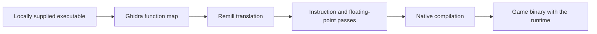
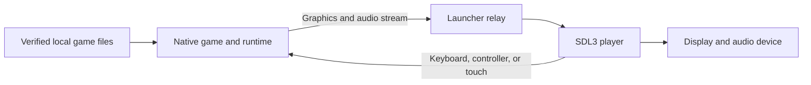

# The architecture of OpenSA2

OpenSA2 keeps the original game logic and replaces the platform services around it. Static recompilation makes that possible without rewriting every game system by hand.

The build translates x86 instructions from a supported 2012 PC executable into LLVM intermediate representation. It patches instruction semantics where required, then compiles the translated functions into native machine code. Generated game code stays outside the tracked source tree.

## Build-time translation

The main translation flow is:

Ghidra provides function ranges, jump-table targets, imports, and other addresses needed to translate the image. The whole-image tools translate mapped functions. Additional tools handle jump-table paths and blocks that the original map does not cover.

Remill supplies the x86 instruction translation. The project's passes adapt that output to its guest memory model, dispatch rules, and floating-point behavior. The original game uses the x87 register stack, including precision and rounding controls that host compilers do not reproduce automatically.

An unresolved target produces a diagnostic trap. The port does not silently replace a missing game block with success. The `_CItan` event failure fixed in 2026-10-15 builds is an example: the x87 tan fallback was an uncovered path until it was translated.

## Guest state and platform services

The runtime maps the executable's data and keeps the game's original 32-bit addresses. Translated functions carry an explicit CPU state. Guest pointers remain guest addresses, and an address table connects indirect calls to translated functions.

`runtime/` supplies the operating-system services that the Windows game expects. These include memory, files, threads, synchronization, time, and device interfaces. The runtime also implements guest-facing Direct3D 9, DirectSound, DirectInput, and XInput behavior.

The filesystem separates verified game files from writable saves and configuration. The installer and launcher prepare those locations and pass them to the runtime.

## The game and the player

The game and the player are separate processes. The game records graphics calls and decoded audio into a stream. A relay passes the stream to the player, which draws frames, plays sound, and sends input back.

The stream contract is in `host/sa2_stream.h`. Its writer is `host/sa2_present_rec.c`. The player reads that contract rather than the game's internal model structures.

The default renderer, `host/d3d9gpu/`, maps recorded Direct3D 9 behavior to SDL3's GPU API. Shader translation uses DXVK and dxbc-spirv code. Linux also has a DXVK Native player, which provides a reference renderer for comparisons.

SDL3 provides the window, audio device, and host input. Android adds an app lifecycle and touch overlay around the same player and stream. A future macOS port still needs platform work and validation.

## Verification and its limits

Different checks answer different questions:

- Function tests compare the machine state produced by translated functions with the original executable.
- Tick replays compare selected game state across a recorded run and identify the first divergence.
- Synthetic streams check recorder and player behavior without game data.
- Renderer comparisons check the output of the same recorded calls through both renderers.
- Installer and launcher tests use synthetic files to check discovery, verification, startup, and shutdown.

These checks have bounded coverage. A replay proves the path it exercises and the fields it compares. A translated and compiling function can still contain a path that reaches a missing block. Full-game parity requires more stage, boss, event, and long-session testing.

Desktop development builds currently use a faster floating-point mode that holds x87 register values in binary64. The build tools retain a native x87 mode for fidelity checks. The faster mode is not a claim that every floating-point result is identical to the original game.

## Code map

| Directory | Responsibility |
| --- | --- |
| `runtime/` | Guest state, memory, dispatch, Windows services, and guest devices. |
| `host/install/` | Steam discovery, file verification, local installation, and configuration. |
| `host/launch/` | First launch, process lifetime, stream relay, and startup self-test. |
| `host/player/` | Stream reader, audio mixer, input, texture decoding, and touch overlay. |
| `host/d3d9gpu/` | Direct3D 9 state and shader translation through SDL3's GPU API. |
| `host/android/` | Android setup, lifecycle, and native session integration. |
| `tools/s2/` and `tools/s3/` | Translation, compilation, jump-table paths, and generated dispatch tables. |
| `tools/spike/pc24pass/` | x87 precision and instruction-semantics passes. |
| `tools/s4/` | Runtime integration, extra blocks, and replay tools. |
| `tools/s7/` and `tools/s8/` | Cross builds, desktop assembly, Android builds, and performance experiments. |
| `harness/` | Function and replay comparison code. |

The [getting-started guide](getting-started.md) describes which checks you can run from the public source preview.
